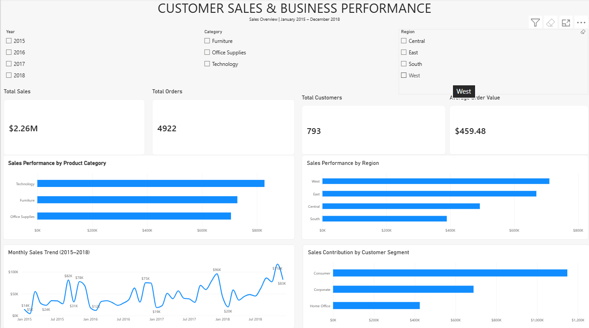

---
# Customer Sales & Business Performance Analytics

An end-to-end data analytics project using Python and Power BI to analyze retail sales performance, customer segments, product categories, regional sales, and monthly trends.

## Project Overview

This project transforms raw retail sales data into business insights using Python-based data analysis and an interactive Power BI dashboard.

The analysis focuses on identifying sales contributions across product categories, understanding customer segment performance, comparing regional sales, and tracking sales trends over time.

## Business Objectives

- Evaluate overall sales performance using key performance indicators.
- Identify the highest-performing product categories.
- Compare sales contributions across customer segments.
- Analyze sales distribution across geographic regions.
- Examine monthly sales trends from 2015 to 2018.
- Assess data quality before performing analysis.
- Present findings through an interactive Power BI dashboard.

## Tools & Technologies

- **Python:** Data analysis and processing
- **Pandas:** Data cleaning, grouping, aggregation, and analysis
- **NumPy:** Numerical computing
- **Matplotlib:** Data visualization
- **Seaborn:** Statistical data visualization
- **Power BI:** Interactive dashboard development
- **DAX:** Dashboard KPI calculation
- **Git & GitHub:** Version control and project hosting

## Dataset Overview

The project uses a retail Superstore sales dataset obtained from Kaggle, published by Rohit Sahoo.

| Attribute | Details |
|---|---|
| Total records | 9,800 |
| Total columns | 18 |
| Unique orders | 4,922 |
| Unique customers | 793 |
| Analysis period | January 2015 – December 2018 |
| Primary metric | Sales |

The dataset contains order information, shipping details, customer segments, geographic attributes, product categories, product names, and sales values.

**Dataset limitation:** The dataset used in this project does not contain profit, cost, discount, or margin fields. Therefore, the analysis focuses on sales performance rather than profitability.

## Key Performance Indicators

| Metric | Value |
|---|---:|
| Total Sales | $2,261,536.78 |
| Sales Records | 9,800 |
| Unique Orders | 4,922 |
| Unique Customers | 793 |
| Average Sales per Record | $230.77 |
| Average Order Value | $459.48 |

Average Order Value is calculated by dividing total sales by the number of distinct orders.

## Key Findings

### 1. Product Category Performance

| Category | Total Sales | Sales Contribution |
|---|---:|---:|
| Technology | $827,455.87 | 36.59% |
| Furniture | $728,658.58 | 32.22% |
| Office Supplies | $705,422.33 | 31.19% |

Technology generated the highest sales and contributed approximately 36.59% of total sales.

### 2. Customer Segment Performance

| Segment | Total Sales | Sales Contribution |
|---|---:|---:|
| Consumer | $1,148,060.53 | 50.76% |
| Corporate | $688,494.07 | 30.44% |
| Home Office | $424,982.18 | 18.79% |

The Consumer segment accounted for approximately half of total sales, making it the largest customer segment by sales value.

### 3. Regional Sales Performance

| Region | Total Sales | Sales Contribution |
|---|---:|---:|
| West | $710,219.68 | 31.40% |
| East | $669,518.73 | 29.60% |
| Central | $492,646.91 | 21.78% |
| South | $389,151.46 | 17.21% |

The West region generated the highest sales, while the South region generated the lowest sales among the four regions.

These results identify areas for further investigation but do not establish the causes of regional or customer performance differences.

## Data Quality Assessment

The dataset was assessed before the main analysis.

- No exact duplicate rows were identified.
- Eleven records contained missing postal codes.
- No invalid order dates were identified.
- No invalid shipping dates were identified.
- Date columns were converted to datetime format.
- Missing postal codes were retained because they do not prevent the planned sales analysis.

## Power BI Dashboard

The interactive dashboard includes:

- **KPI Cards:** Total Sales, Total Orders, Total Customers, and Average Order Value.
- **Product Category Analysis:** Comparison of sales across product categories.
- **Monthly Sales Trend:** Sales trends across the 2015–2018 period.
- **Customer Segment Analysis:** Sales contribution by customer segment.
- **Regional Analysis:** Sales comparison across geographic regions.
- **Interactive Slicers:** Year, Region, and Category filters.

The slicers allow users to explore sales performance across different time periods, regions, and product categories.

## Python Analysis

The Python script performs the following tasks:

1. Loads the retail sales dataset.
2. Checks missing values and duplicate records.
3. Converts order and shipping dates into datetime format.
4. Calculates key business performance indicators.
5. Aggregates sales by product category.
6. Analyzes customer segment performance.
7. Compares regional sales performance.
8. Calculates monthly sales totals.
9. Exports cleaned data and analysis results to CSV files.
10. Generates visualizations for sales analysis.

## Project Structure

```text
Customer-Sales-Business-Performance/
│
├── README.md
├── sales_analysis.py
├── business_insights.md
├── Customer_Sales_Business_Performance.pbix
├── dashboard_preview.png
│
├── outputs/
│   ├── business_kpis.csv
│   ├── category_analysis.csv
│   ├── customer_segment_analysis.csv
│   ├── regional_analysis.csv
│   └── sales_data_clean.csv
│
└── visualizations/
    ├── sales_by_category.png
    └── monthly_sales_trend.png
```

The raw dataset is not listed in this structure. It should be downloaded separately from the original dataset source.

## How to Run the Python Analysis

### Prerequisites

- Python 3
- Pandas
- NumPy
- Matplotlib
- Seaborn

### Installation

Install the required libraries:

```bash
pip install pandas numpy matplotlib seaborn
```

### Dataset Setup

Download the dataset from its original Kaggle source and place `train.csv` in the same directory as `sales_analysis.py`.

Ensure that the `visualizations` directory exists before running the script.

### Run the Analysis

```bash
python sales_analysis.py
```

The script generates cleaned data, KPI reports, category analysis, customer segment analysis, regional analysis, and visualizations.

## Business Recommendations

Based on the observed sales distribution:

1. Investigate the products and subcategories contributing most to Technology sales.
2. Examine purchasing patterns across Consumer, Corporate, and Home Office customers.
3. Investigate the sales gap between the West and South regions.
4. Examine monthly sales patterns to identify potential seasonal trends.
5. Use interactive dashboard filters to support more focused business analysis.

These are recommendations for further investigation, not conclusions about the causes of the observed results.

## Limitations

- Profitability cannot be evaluated because profit, cost, and margin data are unavailable.
- The analysis describes observed sales patterns and does not establish causation.
- The dataset covers January 2015 through December 2018 and may not represent current market conditions.

## Conclusion

This project demonstrates an end-to-end retail sales analytics workflow, combining Python-based data processing, exploratory business analysis, KPI calculations, data visualization, and interactive Power BI reporting.

The resulting dashboard provides a structured view of sales performance across products, customers, regions, and time.

---

**Project Category:** Data Analytics / Business Intelligence

**Primary Technologies:** Python, Pandas, Power BI, DAX
